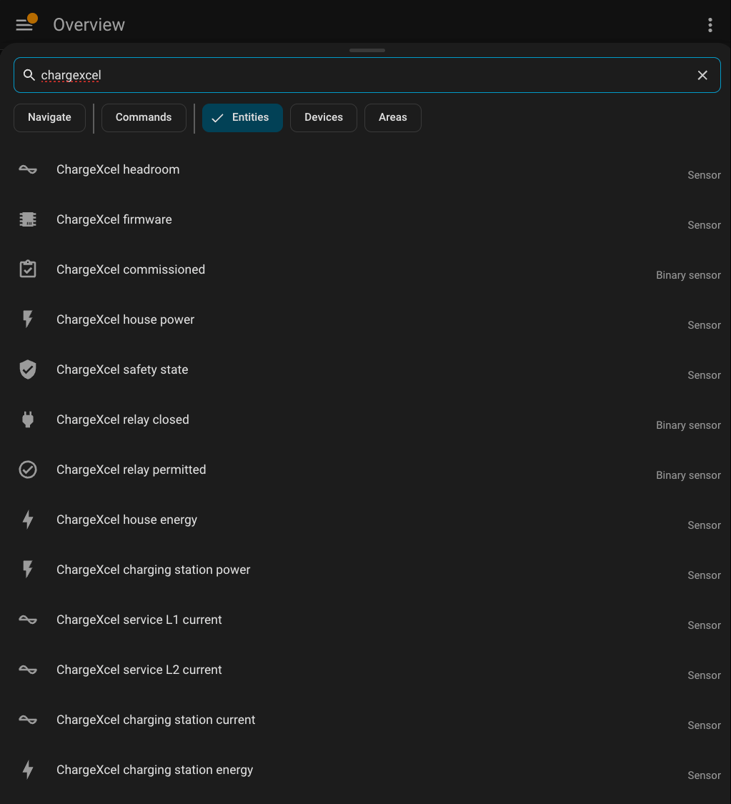
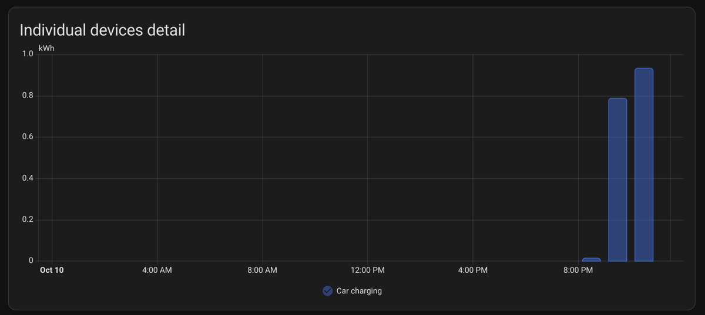
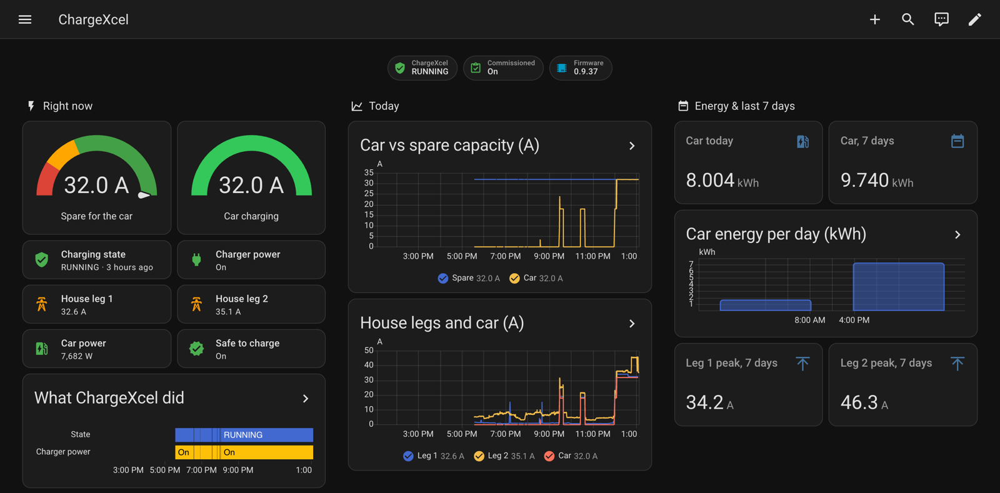
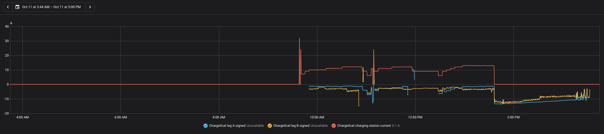

# Using ChargeXcel with Home Assistant

ChargeXcel can be used with [Home Assistant](https://www.home-assistant.io).
This folder has a ready-made package that shows ChargeXcel's live readings and
what it is deciding as Home Assistant sensors, over your home network. No cloud
and no add-ons are needed; it uses Home Assistant's built-in
[RESTful](https://www.home-assistant.io/integrations/rest/) integration.

It is **read-only by design**. Home Assistant can watch ChargeXcel, chart it,
and use it in automations. It cannot open or close ChargeXcel's relay or change
its limits. ChargeXcel keeps protecting your electrical service on its own
whether Home Assistant is running or not.

> ChargeXcel is not a certified "Works with Home Assistant" product, and this
> package is not made or endorsed by the Home Assistant project.

## What you get

| Entity | What it means |
|---|---|
| `sensor.chargexcel_service_l1_current`, `..._l2_current` | Current on each leg of your electrical service, in amps. This is the whole house, including the charging station. |
| `sensor.chargexcel_charging_station_current` | Current the charging station is drawing, in amps. |
| `sensor.chargexcel_headroom` | How many amps ChargeXcel works out the charging station can safely use right now. With net-zero (solar) charging on, this is the lowered figure. It shows *unavailable* while ChargeXcel has no trustworthy figure. |
| `sensor.chargexcel_safety_state` | What ChargeXcel is doing. See the table below. |
| `binary_sensor.chargexcel_relay_closed` | On when the relay is closed and the charging station has power. |
| `binary_sensor.chargexcel_relay_permitted` | On when ChargeXcel's safety logic allows the relay to close. |
| `binary_sensor.chargexcel_commissioned` | On once an electrician has completed setup. |
| `sensor.chargexcel_firmware` | The firmware version running on the unit. |
| `sensor.chargexcel_charging_station_power`, `..._house_power` | Power in watts, worked out from the currents the same way ChargeXcel's own `/energy` page does it. |
| `sensor.chargexcel_charging_station_energy`, `..._house_energy` | Running kWh totals for Home Assistant's Energy dashboard. |

### Safety states

| State | Meaning |
|---|---|
| `RUNNING` | Normal. The service has room, and the charging station may draw power. |
| `SHED_OFF` | The service was near its limit, so ChargeXcel opened the relay to shed the charging load. |
| `RECONNECT_PENDING` | The load has dropped. ChargeXcel is waiting out its reconnect delay before closing the relay again. |
| `READY_OPEN` | Ready, with the relay open. |
| `MANUAL_OFF` | The charging station was switched off from ChargeXcel's own web page. |
| `THERMAL_OFF` | ChargeXcel got too hot and opened the relay. It resumes once it has cooled. |
| `TRIP_LATCHED` | Repeated trips. The relay stays open until the owner clears it on the unit's web page. |
| `SENSOR_FAULT`, `ACTUATOR_FAULT` | ChargeXcel does not trust a sensor or its relay, so it keeps the relay open. |
| `INTERNAL_CT_VERIFYING` | A start-up self-check of its current sensors is in progress. |
| `CONFIG_REQUIRED` | An electrician has not yet completed setup. |
| `BOOT_INHIBITED`, `OTA_INHIBITED` | Starting up, or installing a firmware update. |

## Setup

1. **Get an API key.** Open your ChargeXcel's web page, sign in, go to
   **Menu → API key**, and copy the key. Anyone with this key can read
   ChargeXcel's readings, but it cannot change anything. If you regenerate the
   key, update Home Assistant too.
2. **Find the unit's address.** Every ChargeXcel has its own permanent name,
   `chargexcel-XXXX.local`, where `XXXX` is the last four characters of its
   Wi-Fi setup network name. Your router also lists it as `chargexcel-XXXX`. A
   fixed IP address from your router works too.
3. **Add two lines to `secrets.yaml`.** Keep the quotes around the key.
   Without them, a key that happens to look like a number gets mangled.
   ```yaml
   chargexcel_diagnostics_url: http://chargexcel-XXXX.local/api/diagnostics
   chargexcel_api_key: "paste-the-key-here"
   ```
4. **Turn on packages**, if you haven't already, in `configuration.yaml`:
   ```yaml
   homeassistant:
     packages: !include_dir_named packages
   ```
5. **Copy [`chargexcel.yaml`](chargexcel.yaml)** into the `packages` folder
   next to `configuration.yaml`.
6. **Edit it for your service:**
   - If your service is 120/208 V, change `240` to `208` on the
     charging-station power line.
   - If you have solar panels, delete the house power and house energy
     sensors. ChargeXcel's current sensors can't tell exported power from
     imported, so that figure is not meaningful.
7. **Restart Home Assistant.** The sensors fill in within about 10 seconds.
   ChargeXcel shows up as 13 entities, not as a device, so you won't find it
   on the Devices tab. Press **`e`** anywhere in Home Assistant and search
   **chargexcel** to check they're all there:

   

   The same list is under **Settings → Devices & services → Entities**.
8. **Optional: add the car to the Energy dashboard.** Go to
   **Settings → Dashboards → Energy**. Under **Individual electrical
   devices**, choose **Add device** and pick **ChargeXcel charging station
   energy**. Home Assistant says new data can take up to 2 hours to appear.
   After that, the car's charging shows up hour by hour, separate from
   everything else:

   
9. **Optional: add the ready-made dashboard.** See below.
10. **Optional: solar charging graphs.** See [Solar charging graphs](#solar-charging-graphs-optional).

## A ready-made dashboard

[`dashboard.yaml`](dashboard.yaml) is a complete ChargeXcel dashboard built
only from Home Assistant's own cards, so there is nothing to install from
HACS:



- **Right now:** how many amps are spare for the car and how many it is
  drawing, what ChargeXcel is doing, and the current on each service leg. A red
  **Needs attention** tile appears only when ChargeXcel is not running
  normally: charging paused to protect your service, too hot, latched off, or
  offline.
- **Today:** the car against the spare capacity it is allowed, and both
  service legs with the car. With net-zero (solar) charging on, the car's line
  follows the sun.
- **Energy & last 7 days:** the car's energy today, over the last 7 days and
  per day, and the highest each service leg reached this week. Compare those
  peaks with your service rating before adding a heat pump, a hot tub or a
  second EV.

To use it: **Settings → Dashboards → Add dashboard → New dashboard from
scratch**. Open the new dashboard, click the pencil, then **⋮ → Raw
configuration editor**, replace everything with the contents of
`dashboard.yaml`, and save. The file's first lines list the two things worth
adjusting: the dials' maximum (your charging station's rating) and, if you
like, your service rating in the peak cards' names.

The 7-day cards and the per-day chart use Home Assistant's long-term
statistics, so they start nearly empty and fill in over the first week.

## Solar charging graphs (optional)

If you use ChargeXcel's solar charging, a small add-on shows what it is doing.
ChargeXcel's current sensors measure how much current flows, not which way,
so on their own they can't tell export from import. ChargeXcel works the
direction out by stepping the car's charge rate and watching each leg. This
add-on reads that call and draws each leg as **import above zero, export
below zero**:



It adds:

| Entity | What it means |
|---|---|
| `sensor.chargexcel_net_zero_phase` | What solar charging is doing: `tracking` (following the sun), `resolving` (working out which way power flows), `probing` (a small test step), `waiting`, `outside_window` or `off`. |
| `sensor.chargexcel_net_zero_mode` | `min_solar` or `solar_only`. |
| `sensor.chargexcel_leg_a_direction`, `..._leg_b_direction` | `export`, `import` or `unknown`, for service leg 1 and leg 2. |
| `sensor.chargexcel_leg_a_signed`, `..._leg_b_signed` | Each leg's current, negative when exporting. *Unavailable* while ChargeXcel isn't sure of the direction. |
| `sensor.chargexcel_allowed_amps_before_solar` | The most the car may safely draw. |
| `sensor.chargexcel_allowed_amps_after_solar` | What solar charging is steering the car to. |
| `sensor.chargexcel_solar_holding_back` | The gap between the two: how much solar charging is holding the car back. |

It reads ChargeXcel's plugin feed, so it needs its own key:

1. **Add a plugin on ChargeXcel.** Open its web page, go to **Load
   Management Plugins** (`/dlm`), open **External plugins**, type
   `Home Assistant` as the name and press **Add plugin**. Copy the key it
   shows. It is shown only once; if you lose it, revoke the plugin and add a
   new one.
2. **Add two lines to `secrets.yaml`,** keeping the quotes around the key:
   ```yaml
   chargexcel_tick_url: http://chargexcel-XXXX.local/api/dlm/v1/tick
   chargexcel_dlm_key: "paste-the-key-here"
   ```
3. **Copy [`chargexcel_solar.yaml`](chargexcel_solar.yaml)** into the
   `packages` folder next to `chargexcel.yaml`, and restart Home Assistant.
4. **Optional: add the Solar charging section to the dashboard.** Open it,
   click the pencil, then **⋮ → Raw configuration editor**, and paste the
   contents of [`dashboard-solar-section.yaml`](dashboard-solar-section.yaml)
   at the end of the `sections:` list.

On ChargeXcel's `/dlm` page, Home Assistant now shows as an online plugin
"Logging to Home Assistant". That is all a plugin can do: it reports that it
is there. Nothing it sends changes what ChargeXcel does. The import and export
signs are ChargeXcel's own judgement, made from how the legs respond to the
car, not a reading from a separate meter. Needs firmware 0.9.24 or later.

## Good to know

- **Poll rate.** The package asks ChargeXcel once every 10 seconds, which is
  plenty for a dashboard. Please don't go faster than every 5 seconds.
  ChargeXcel's web server handles only a few connections at once, and a fast
  poller can crowd out your browser.
- **Reboots.** The API key survives reboots and firmware updates. The sensors
  show *unavailable* while ChargeXcel restarts and come back on their own.
- **Energy history.** The kWh sensors are Home Assistant's own totals and start
  at zero the day you add them. ChargeXcel keeps its own long-term history on
  its `/energy` page, and as a CSV download from `/api/energy/export.csv`,
  which accepts the same `X-API-Key` header.
- **An idle charging station reads 0 W.** With nothing drawing, the
  charging-station current sensor rests at about 0.06-0.08 A. The package
  counts anything under 0.1 A as zero, so that resting noise doesn't add
  phantom kWh to the Energy dashboard. A car never charges below 6 A, so real
  charging is unaffected. If you installed the package before this change,
  copy the new `chargexcel.yaml` over the old one and restart.
- **Older firmware.** The safety-state, headroom and firmware sensors need
  firmware that reports `"schema": 3` or later on `/api/diagnostics`. Older
  firmware still gives you the currents and relay state, and shows the rest
  as *unavailable*.

## Troubleshooting

**Every ChargeXcel sensor shows *unavailable*.** Home Assistant cannot read
the unit. Check it from any computer on the same network, using the same
address and key as `secrets.yaml`:

```sh
curl -H "X-API-Key: paste-the-key-here" http://chargexcel-XXXX.local/api/diagnostics
```

- **You get JSON back:** the unit is fine. Check `secrets.yaml` for a typo,
  check that the key is in quotes, then restart Home Assistant.
- **`401`:** the key is wrong, or it was regenerated on the unit's
  **API key** page. Copy the current key into `secrets.yaml` and restart.
- **The name doesn't resolve, or the request times out:** your network may
  not pass `.local` names to Home Assistant. This is most common when Home
  Assistant runs in Docker. Use the unit's IP address instead, and ask your
  router to always give the unit the same address.
- Home Assistant's own error is under **Settings → System → Logs**. Search for
  `rest`.

**Only the safety state, headroom and firmware sensors are *unavailable*.**
The unit's firmware is older than `"schema": 3`. See "Older firmware" above.

**The sensors drop out for a few seconds now and then.** That is usually a
restart or a firmware update on the unit, and they come back on their own. If
it happens often, check that nothing else is polling the unit faster than
every 5 seconds.

**The energy cards or the per-day chart are empty.** They start from zero on
the day you add the package. The statistics cards can lag by up to an hour,
and the Energy dashboard by up to 2 hours.

**The house power and energy sensors look wrong.** If you have solar panels,
delete them. See step 6.

## The JSON behind it

`GET /api/diagnostics` with header `X-API-Key: <key>`:

```json
{
  "schema": 3,
  "version": "0.9.32",
  "time": {"epoch": 1790000000, "trusted": true},
  "ct": {"service_l1_amps": 31.500, "service_l2_amps": 28.250, "evse_amps": 24.000},
  "relay": {"energized": true},
  "safety": {"state": "RUNNING", "relay_permitted": true},
  "headroom": {"amps": 22.500, "valid": true},
  "electrician": {"valid": true, "service_rating_amps": 100.0, "...": "..."}
}
```

New fields may be added in later firmware. Existing fields keep their names and
meanings, and `schema` goes up when something is added.
